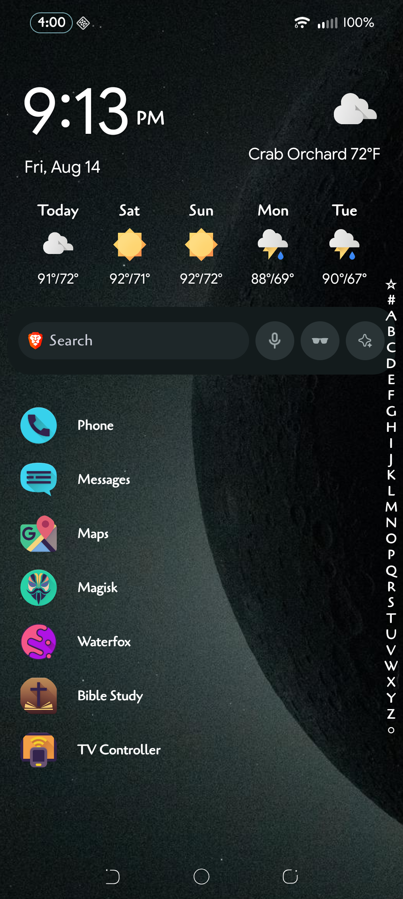
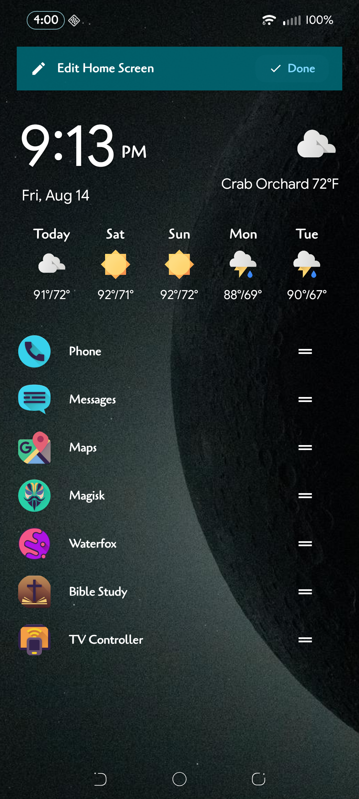
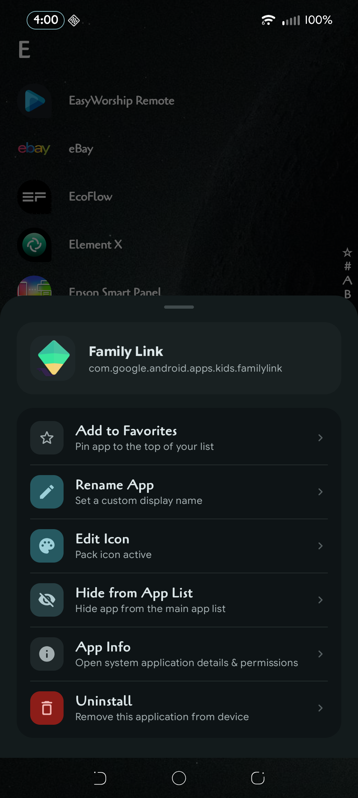
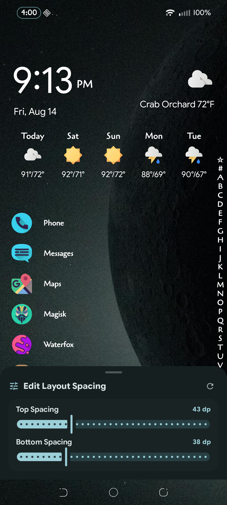
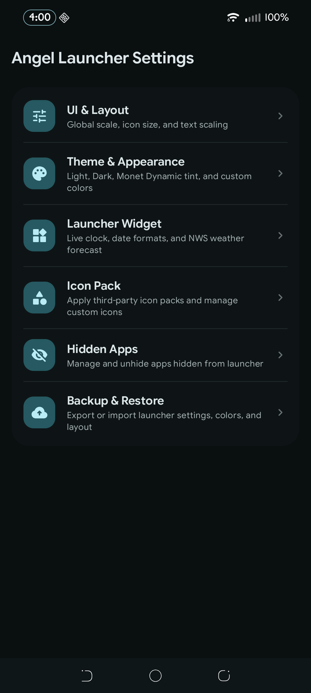

<div align="center">
  
  <h1>Angel Launcher</h1>
  <p>A fast, lightweight, and minimalist Android home screen launcher designed for speed, visual clarity, and seamless daily use.</p>
</div>

---

## 🤖 Built with AI

> **Important Disclosure & Development Story:**  
> I do **not** know how to write code. This entire project was created using AI pair programming.  
> * **Google Gemini** did the vast majority of the core architecture, Kotlin/Android development, Jetpack Compose UI, custom vector icons, R8 optimizations, and feature implementations.  
> * **Anthropic Claude** assisted with codebase auditing, bug finding, edge-case checking, and quality review.  

---

## 📸 Screenshots

| Home Screen & Weather | Edit Home Screen | App Options Menu |
| :---: | :---: | :---: |
|  |  |  |

| Layout Spacing Controls | Settings Dashboard |
| :---: | :---: |
|  |  |

---

## ✨ Key Features

* **⚡ Ultra Fast & Instant Loading**: 
  - Sub-2.5 MB optimized production release APK.
  - Zero-delay (0ms) instant cached favorites loading upon startup and resume with flicker-free `DiffUtil` background refreshes.
* **🌤️ Live Weather & NWS Forecast**:
  - Live temperature, condition icons, and 7-period weather forecasts powered directly by the National Weather Service (NWS / weather.gov API).
  - GPS device location detection or manual city/state search.
* **🎨 Deep Appearance & Theme Customization**:
  - Light, Dark, and System Default theme modes.
  - Custom color picker with opacity sliders for app text, clock, search bar, and alphabet scrubber.
  - Subtle text shadow layers for readability against bright wallpapers.
* **🧩 Universal Icon Masking & Icon Packs**:
  - Full third-party Android icon pack support with dynamic icon extraction and fallback masking.
  - 6 real-time adaptive icon shapes: **Default**, **Circle**, **Squircle**, **Rounded Square**, **Teardrop**, and **Hexagon**.
  - Individual per-app icon customization and custom labeling.
* **🔍 Fast Gesture Scrubber & Search**:
  - Right-edge alphabetical fast-scroll scrubber with haptic touch feedback.
  - Instant fuzzy app search and recently opened apps tray.
* **🛡️ Glass-Clear System Bars**:
  - Full edge-to-edge layout drawing behind status and navigation bars.
  - Built-in System Bar Contrast Enforcement bypass (Android 10+ / API 29–35) for 100% transparent navigation bars without translucent grey scrims.
* **💾 Backup & Restore**:
  - Export and import all launcher preferences, color themes, hidden apps, and favorite app layouts to a JSON file.

---

## 🛠️ Tech Stack & Architecture

- **Platform**: Android (Kotlin, API 26–35+)
- **UI Architecture**: Hybrid architecture — High-performance standard Views & `RecyclerView` for the home screen launcher and fast scrubber, paired with **Jetpack Compose** for Settings and Bottom Sheets.
- **Local Persistence**: Room Database + SharedPreferences (`SettingsManager`)
- **Networking & Async**: Kotlin Coroutines, Flow, OkHttp3, AndroidX WorkManager
- **Build & Optimization**: Gradle 9+, R8 Full Mode minification, resource shrinking, ABI splitting support

---

## 📦 Building from Source

### Prerequisites
- Android Studio Ladybug / Meerkat or command-line SDK tools
- JDK 17
- Android SDK Platform 35

### Build Release APK
Navigate to `angel-launcher` and execute:
```bash
cd angel-launcher
./gradlew assembleRelease
```
The optimized release APK will be generated at:
`angel-launcher/app/build/outputs/apk/release/app-release.apk`

### Install on Device via ADB
```bash
adb install -r angel-launcher/app/build/outputs/apk/release/app-release.apk
```

---

## 📄 License

This project is licensed under the **GNU General Public License v3.0 (GPLv3)**. See the [LICENSE](LICENSE) file for the full license text.
